# NULQ

**Find the boundary. Understand the exposure.**

NULQ is a read-only Linux privilege-boundary discovery and evidence-driven
security assessment framework written in Go. It collects normalized
observations about how a system grants authority, evaluates detection rules
against those observations, and emits findings traceable back to the exact
facts that caused them.

Standard library only. No runtime dependencies. Static builds for
linux/amd64 and linux/arm64.


---

## Overview

NULQ answers one question precisely: how does this system grant authority,
and what evidence supports that claim?

It does not exploit, execute, or modify anything on the assessed system.
Collectors open files read-only and publish typed, immutable observations.
Detection rules interpret those observations and produce findings that cite
their evidence. Every finding states its limitations next to its claim.

NULQ is authorised-use software for post-access assessments, hardening
reviews, CTF and laboratory environments, and automated security pipelines.
It is not an exploitation tool, a persistence tool, or a remote-control
service.

---

## Why NULQ

**Observation-first.** Collectors normalise system state into a closed
vocabulary of observation kinds. Rules consume a shared store; they never
traverse the filesystem themselves. A rule that needs new facts gets a new
observation kind, not its own traversal.

**Evidence-backed.** Every finding cites at least one evidence item that
resolves to an observation ID. Evidence identifies the observation, the
field, and the observed value — it never restates a conclusion.

**Conservative conclusions.** Presence is not vulnerability. Unknown or
incomplete evidence is never treated as confirmed exploitability. When a
rule cannot decide, it reports less, not more.

**Honest coverage.** A completed execution is not a complete assessment.
Coverage separates `execution_complete` from `coverage_complete`, and both
are published. Permission-denied paths are reported as unavailable, never
silently swallowed.

---

## Architecture

```mermaid
flowchart TD
    subgraph ENV["Linux environment"]
        A[Processes]
        B[Filesystems]
        C[Mounts]
        D[ACLs]
        E[Services]
        F[SSH config]
        G[Sudoers]
        H[Cron jobs]
    end

    subgraph COLLECT["Discovery collectors"]
        I[linux.system]
        J[linux.identity]
        K[linux.filesystem]
        L[linux.process]
        M[linux.sudo]
        N[linux.cron]
        O[linux.container]
        P[linux.systemd]
        Q[linux.sshd]
    end

    subgraph OBS["Normalized observations"]
        R[Typed observations]
        S[Closed vocabulary]
        T[Immutable store]
        U[Content-derived IDs]
    end

    subgraph REL["Relationship model"]
        V[Entities and edges]
        W[Observation references]
        X[Evaluation outcome]
    end

    subgraph DETECT["Detection engine"]
        Y[20 registered rules]
        Z[Prerequisite gating]
        AA[Severity & confidence]
    end

    subgraph EVID["Evidence & correlation"]
        AB[Evidence chain]
        AC[Relationship graph]
    end

    subgraph REPORT["Reporting interfaces"]
        AD[Terminal]
        AE[JSON]
        AF[JSONL]
        AG[Markdown]
    end

    ENV --> COLLECT
    COLLECT --> OBS
    OBS --> REL
    REL --> DETECT
    DETECT --> EVID
    EVID --> REPORT
```



**Pipeline stages:**

| Stage | What it does |
|-------|--------------|
| Discovery collectors | Nine read-only collectors observe system, identity, filesystem, process, sudo, cron, container, systemd, and sshd state |
| Normalized observations | Typed, immutable observations with stable, content-derived IDs; never contain secrets |
| Relationship model | Entities and edges with observation references; observed and inferred edges distinguishable by evaluation outcome |
| Detection engine | 20 registered rules across identity, filesystem, process, system, and SSH domains; prerequisite gating skips rules whose observations are absent |
| Evidence & correlation | Every finding cites evidence that resolves to observation IDs; aggregation enforces referential integrity |
| Reporting interfaces | Terminal, JSON, JSONL, and Markdown output; machine-readable output is sterile (no ANSI, banners, or log records on stdout) |

---

## Capabilities

| Domain | Rules | What they detect |
|--------|-------|------------------|
| Identity | NULQ-ID-001, ID-002, ID-003, ID-004, ID-006 | Privileged group membership, sudoers policy, cron jobs, non-root UID-0 accounts, writable SSH authorized_keys |
| Filesystem | NULQ-FS-001, FS-002, FS-003, FS-004, FS-005 | SUID/SGID executables, world-writable directories, unsafe PATH entries, mount flag constraints, file capabilities |
| Process | NULQ-PROC-001 | Writable parent directory of an executable consumed by a running process |
| System | NULQ-SYS-001 through SYS-009 | Kernel sysctl hardening, MAC posture, process capabilities, seccomp, systemd unit hardening, user namespaces, kernel mitigations, container indicators, sshd configuration |

Full rule metadata is available via `nulq rules list --format json`.

---

## Detection coverage

20 rules are registered across five modules:

| Module | Rules |
|--------|-------|
| identity | NULQ-ID-001, ID-002, ID-003, ID-004, ID-006 |
| filesystem | NULQ-FS-001, FS-002, FS-003, FS-004, FS-005 |
| process | NULQ-PROC-001 |
| system | NULQ-SYS-001, SYS-002, SYS-003, SYS-004, SYS-005, SYS-006, SYS-007, SYS-008, SYS-009 |

Rules are gated on required observation kinds. If a rule's prerequisites are
absent, the engine skips it and records the reason. Unavailable data never
becomes an approximation.

---

## Installation

NULQ is a single static binary with no runtime dependencies. Go 1.24.0 or
later is required to build it.

```bash
# Build for the host architecture
make build

# Cross-compile for linux/amd64
CGO_ENABLED=0 GOOS=linux GOARCH=amd64 go build ./cmd/nulq

# Cross-compile for linux/arm64
CGO_ENABLED=0 GOOS=linux GOARCH=arm64 go build ./cmd/nulq
```

Release artifacts (checksums included) are produced by `make release`. There
is no published release yet; build from source.

---

## Quick start

```bash
# Show the CLI reference
nulq --help

# Run a full assessment (terminal output)
nulq scan

# JSON report to a file (created with mode 0600)
nulq scan --format json --output report.json

# Scan specific modules only
nulq scan --modules identity,filesystem

# Scan specific rules only
nulq scan --rules NULQ-FS-001,NULQ-PROC-001

# List registered rules
nulq rules list

# Show collected system facts
nulq system info

# Print build metadata
nulq version
```

Diagnostics go to stderr. Machine-readable output never contains banners,
progress output, colour, or log records.

### Exit codes

| Code | Meaning |
|------|---------|
| 0 | Completed; no failure threshold met |
| 1 | Runtime failure (I/O error, cancellation, invalid internal state) |
| 2 | Usage error (unknown flag, module, rule, format, command) |
| 3 | `--fail-on` was set and a finding met or exceeded the threshold |

```bash
# Exit 3 when any finding at MEDIUM or above exists
nulq scan --fail-on medium
```

---

## Output formats

| Format | Use |
|--------|-----|
| `terminal` | Human-readable report with optional colour (default) |
| `json` | Structured JSON report, schema version 1.1 |
| `jsonl` | JSON Lines, one object per line |
| `markdown` | Markdown report for documentation and sharing |

Output files are created with mode 0600. Reports are treated as sensitive —
they can contain host configuration details.

---

## Testing and verification

```bash
gofmt -l .          # must be empty
go vet ./...        # static analysis
go test ./...       # unit and integration tests
go test -race ./... # race detector clean
make build          # host binary
make lab-test       # Docker laboratory: 34/34 scenarios pass, 5 unsupported
```

The laboratory builds the real binary, executes it unprivileged inside a
pinned Alpine 3.22 container, validates reports against the published JSON
schema, and evaluates scenario expectations explicitly.

---

## Project structure

```
cmd/nulq          — entry point (signal handling + exit code only)
internal/app      — wiring: collectors, rules, report generation
internal/cli      — flags, output routing, exit codes
internal/core     — models, errors, interfaces
internal/engine   — registry, store, executor, aggregation, correlation
internal/evidence — evidence builder
internal/lab      — laboratory manifest, schema validator, verdict engine
internal/platform/linux/* — collectors (system, identity, filesystem, process, sudo, cron, container, systemd, sshd)
internal/reporting — renderers and sanitizers
internal/rules/*  — detection rules grouped by domain
pkg/api           — public report types
schemas/          — published JSON Schema
lab/              — Docker laboratory, fixtures, scenarios, scripts
tests/integration — end-to-end fixture scenarios
docs/             — architecture, models, threat model, ADRs
```

---

## Security model and limitations

**Read-only.** No code path modifies the assessed system, starts or stops
services, executes discovered binaries or scripts, or attempts exploitation.

**No network.** NULQ makes no network connections and requires no database
or interpreter.

**Unprivileged operation.** Works as an ordinary user. Permission-denied
paths are reported as unavailable, never bypassed.

**Sanitized output.** Control characters are stripped before terminal and
Markdown rendering; a hostile filesystem cannot inject terminal escapes.

**Deterministic identifiers.** Observation, evidence, and finding IDs derive
from content, never from time or iteration order.

**Limitations:**
- Alpine is a minimal BusyBox userland; it cannot represent systemd, PAM,
  SELinux, or distribution package layout. Those checks are synthetic
  fixtures or unsupported scenarios.
- The container kernel is shared with the Docker host; sysctl values describe
  that kernel, not a bare-metal server.
- Docker is a prerequisite for laboratory testing and is not installed by
  this project.
- NULQ remains read-only; the lab verifies this by behaviour rather than
  kernel auditing.
- Docker is a prerequisite for laboratory testing and is not installed by
  this project.

Full security policy: [SECURITY.md](SECURITY.md).

---

## Contributing

See [CONTRIBUTING.md](CONTRIBUTING.md) for the contribution guide. Key
governance documents:

- [AGENTS.md](AGENTS.md) — engineering constitution with host-protection policy
- [MISSION.md](MISSION.md) — current milestone scope
- [ROADMAP.md](ROADMAP.md) — milestone sequence and acceptance criteria
- [CHANGELOG.md](CHANGELOG.md) — project history
- [docs/decisions/](docs/decisions/) — architecture decision records

NULQ is pre-1.0. Interfaces may change, but report schema version 1.1 is a
compatibility commitment.

---

<sup>© 2026 Dustin Oprea</sup>
