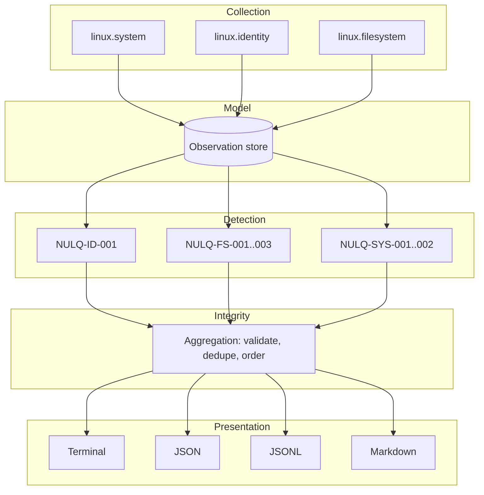

# Architecture

## Objective

NULQ turns low-level Linux facts into defensible findings about privilege
boundaries. The architecture exists to make that transformation auditable,
extensible and deterministic.

## Layers

Collection, interpretation and presentation are strictly separated:

- Collectors never decide what is dangerous.
- Rules never read the system, spawn processes or print.
- Renderers never compute severity or reach into collectors.

## Package map

| Path | Responsibility | Must not |
|---|---|---|
| `cmd/nulq` | signal handling, exit code | contain logic |
| `internal/app` | select rules, build collectors, assemble report | parse flags |
| `internal/cli` | flags, validation, output routing, exit codes | detect |
| `internal/platform/linux/system` | host, LSM, sysctl observations | interpret severity |
| `internal/platform/linux/identity` | credentials, groups, namespaces | classify groups |
| `internal/platform/linux/filesystem` | mounts, notable entries, PATH | judge exposure |
| `internal/core/models` | contracts and invariants | import engine |
| `internal/core/interfaces` | Collector, Rule, ObservationSet | know implementations |
| `internal/core/errors` | error classes | swallow errors |
| `internal/engine/store` | immutable observation index | mutate after publish |
| `internal/engine/registry` | rule registration and selection | execute rules |
| `internal/engine/executor` | concurrency, timeouts, isolation | render |
| `internal/engine/aggregation` | integrity, dedupe, ordering | detect |
| `internal/rules/*` | interpretation and explanation | enumerate the system |
| `internal/reporting` | rendering and sanitization | decide findings |
| `internal/lab` | lab manifest, schema validation, verdict engine | implement detection |
| `lab/verify` | laboratory validation entry point | scan the target |
| `pkg/api` | public report types | expose internals |

## Scan lifecycle

1. **Selection.** The registry validates metadata and resolves modules/rule
   IDs. Unknown selections are errors, not silently empty scans.
2. **Collection.** Independent collectors run concurrently under a semaphore
   and a collector timeout. Each returns observations and an optional error.
   Observations are retained even when a collector reports partial failure.
3. **Publication.** The store deduplicates by observation ID (preferring the
   more complete status), sorts deterministically, and exposes a read-only
   view.
4. **Detection.** Each rule runs under the shared semaphore with its own
   timeout. Rules whose required observation kinds are absent are skipped with
   a recorded reason. A panic or error fails only that rule.
5. **Validation.** The engine rejects findings with no evidence, invalid
   severity/confidence, a mismatched rule ID, or an evidence reference the rule
   did not return.
6. **Aggregation.** Evidence references are checked for existence, findings
   are deduplicated by stable ID with evidence unioned, and output is sorted by
   severity, rule, resource, title, ID.
7. **Report assembly.** Host metadata, coverage, statistics, limitations and
   the tool identity are combined into a versioned report.
8. **Rendering.** The selected renderer emits to stdout or a 0600 file.
   Diagnostics go to stderr only.

## Concurrency model

- A single semaphore bounds collectors and rules (`--concurrency`).
- Collectors are independent and write to disjoint result slots; no shared
  mutable state.
- The observation store is immutable after publication, so rules read it
  concurrently without locks.
- The evidence builder and rules are single-goroutine per evaluation.
- Cancellation is checked at collection boundaries, before each rule, and
  inside filesystem traversal and rule loops.

## Failure semantics

| Situation | Representation |
|---|---|
| Path unreadable | Observation `unavailable` with class `permission_denied` |
| Kernel knob absent | Observation `unavailable` with class `not_found` |
| Traversal budget exhausted | Scan summary `partial`, report `partial`, limitation entry |
| Collector returns partial data + error | Observations retained, collector status `failed` |
| Rule panics | Rule status `failed`, other rules unaffected |
| Rule exceeds timeout | Rule status `failed` with timeout class |
| Finding violates invariants | Rule status `failed`, findings discarded |
| Overall scan canceled | Partial report plus error; CLI exits 1 |

## Determinism

- Observation, evidence and finding IDs are SHA-256-derived from content.
- Store ordering is `(kind, resource, id)`.
- Evidence is sorted by ID; findings by severity/rule/resource/title/ID.
- Reports contain timestamps and a host-derived report ID; otherwise repeated
  scans of unchanged state are identical.

## Extension points

- **New observation kinds:** add the kind, document attributes, implement a
  collector, add store/coverage handling.
- **New rule:** implement `interfaces.Rule`, register in
  `internal/rules/rules.go`.
- **New output format:** add a renderer in `internal/reporting` and a CLI
  format value; never mix formats on one stream.
- **Relationship graph (M5):** consume the same observation store; do not add
  a second collection path.

## Deliberate omissions

- No plugin loading, network listener, remote control or database.
- No dynamic rule discovery: the binary contains exactly the documented rules.
- No graph implementation yet; see `relationship-graph.md`.
