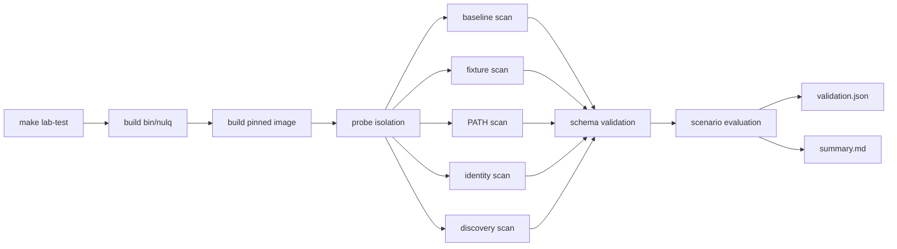

# Laboratory architecture

## Purpose

The laboratory answers a question unit tests cannot: **does the shipped binary
produce correct, schema-valid, evidence-backed results on a Linux system that is
not the developer's machine?**

It executes the real binary in a controlled environment, validates the output
and judges explicit expectations. It contains no detection logic.

## Topology

```text
host (unprivileged owner account)
│
├── bin/nulq  ──────────────── read-only bind mount ──┐
│                                                     │
├── lab/compose.yaml ── docker compose (project nulq-lab)
│     ├── nulq-baseline   uid 10001, full Alpine, fixtures masked
│     ├── nulq-fixtures   uid 10001, --root /lab/fixtures
│     ├── nulq-path       uid 10001, hostile PATH, --root /lab/fixtures
│     ├── nulq-identity   uid 10001 + group 10, identity module only
│     ├── nulq-discovery  auto-discovered mounts, 5 000-entry budget
│     ├── lab-probe       isolation assertions → JSON
│     └── lab-target      sleep infinity, manual inspection
│
└── lab/results/  scan*.json · isolation.json · image.json · validation.json · summary.md
```

One image, seven services. The image contains BusyBox, one unprivileged account
and deterministic fixtures; every service shares the same security anchor.

## Data flow



The host captures container stdout with shell redirection. No writable volume is
mounted into the container, which keeps the read-only-root claim true and avoids
uid-mapping problems with result files.

## Scans

| Artifact | Service | Scope | Purpose |
|---|---|---|---|
| `scan.json` | `nulq-baseline` | `--root /` | live Alpine userland; `/lab/fixtures` hidden by an empty tmpfs |
| `scan-fixtures.json` | `nulq-fixtures` | `--root /lab/fixtures` | SUID/SGID, permissions, nesting, unreadable subtree |
| `scan-path.json` | `nulq-path` | `--root /lab/fixtures`, hostile PATH | writable, empty, late, symlinked, non-writable and missing PATH entries |
| `scan-identity.json` | `nulq-identity` | identity module | wheel membership granted by the runtime |
| `scan-discovery.json` | `nulq-discovery` | auto-discovered mounts, 5 000-entry budget | excluded `/proc` and `/sys` reported separately from traversal denials |

All scans pass `--format json --observations --color never`. Observations are
required so scenarios can assert on raw facts (for example `path_exists=false`),
not only findings.

## Validation

`lab/verify` (backed by `internal/lab`) performs four independent checks:

1. **Structural.** Every report is validated against
   `schemas/nulq-report-v1.schema.json` with a local JSON Schema subset
   validator (`const`, `type`, `required`, `properties`,
   `additionalProperties`, `items`, `enum`, `pattern`, `minLength`, `minItems`,
   `minimum`, `format` date-time/uri, local `$ref`). The subset is small on
   purpose: no dependency and no silent skipping of unknown keywords is claimed.
   When Python `jsonschema` is installed, `lab/scripts/validate-schema.py` adds
   a cross-check from an unrelated implementation.
2. **Isolation.** Probe facts are converted into pass/fail assertions and any
   failure fails the whole run.
3. **Scenarios.** Each manifest entry is evaluated against its scan artifact:
   expected findings (rule, resource, severity, confidence, count), absent
   findings, observations (kind, resource, status, attribute equality, count),
   coverage facts (including required excluded roots), scan metadata and a
   maximum severity. Findings inside the scenario's declared scope that no
   expectation claims are reported as unexpected and fail the scenario.
4. **Integrity and accounting.** Duplicate findings, evidence IDs that do not
   resolve to an evidence record in the same report, and findings that cite no
   evidence fail the whole run. Per scan, every finding must be matched by an
   assertion or explicitly listed under `allowed_findings`; an unaccounted
   finding fails the run regardless of scenario `scope`.
5. **Artifacts.** Every scenario names a scan in the manifest; a missing or
   schema-invalid artifact fails every scenario that depends on it.

## Failure semantics

| Situation | Result |
|---|---|
| Docker absent or daemon unreachable | script exits with a prerequisite error; nothing is installed |
| Binary missing | `lab-build`/`lab-test` stop before running Docker |
| Image missing | `lab-test` requires `lab-build`; `lab-up` builds it |
| Container exits non-zero or prints nothing | `lab-test` fails on the empty artifact |
| Report violates the schema | scan marked invalid; dependent scenarios fail |
| Isolation property not established | run fails, limitation added |
| Expected finding missing | scenario fails, finding listed under `missing` |
| Extra finding in scope | scenario fails, finding listed under `unexpected` |
| Unsupported category | reported as `unsupported`, excluded from pass counts |

## Determinism

Report IDs and timestamps differ per run by design. Everything the laboratory
judges is state-derived: fixture paths, modes, ownership, group membership,
rule IDs, severities, confidence, coverage counts and ordering. Repeated runs
against the same image produce identical scenario verdicts; unexpected
non-determinism is a defect.

## Why Alpine

See [ADR 0008](../decisions/0008-docker-alpine-laboratory.md). Alpine 3.22 is
~12 MB, has no systemd or package-manager side effects, starts in under a
second and contains no SUID binaries, which makes fixture-driven SUID scenarios
unambiguous.

## Extension points

- **New rule/fixture scenario:** add the fixture in `setup-fixtures.sh`, add the
  scenario to `lab/scenarios/manifest.json`, rebuild, run `make lab-test`.
- **New scan profile:** add a Compose service using the shared security anchor,
  add an artifact mapping in the manifest, run it from `lab-test.sh`.
- **New report field:** update the schema and `internal/lab` only if a scenario
  needs to assert it; the validator follows the schema rather than a hard-coded
  shape.
