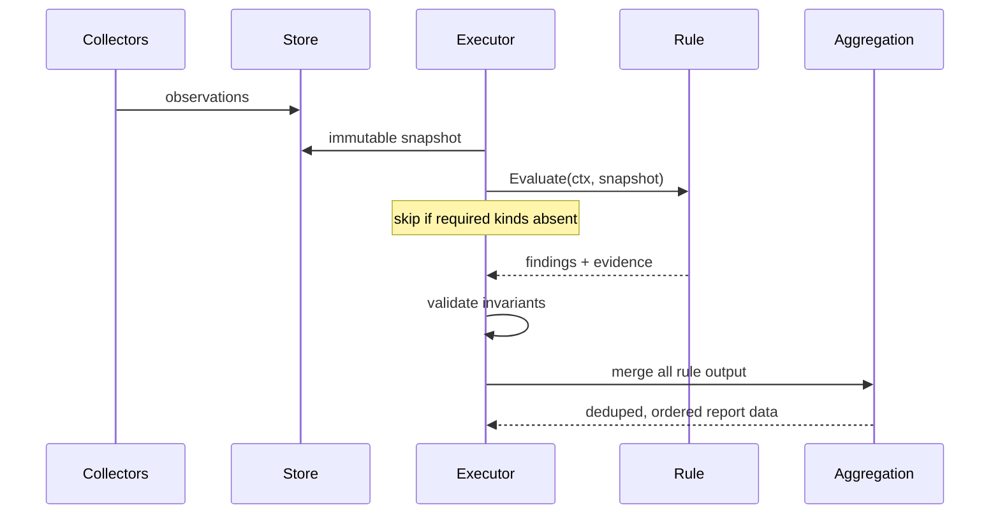

# Detection engine

## Rule contract

```go
type Rule interface {
    Metadata() models.RuleMetadata
    Evaluate(ctx context.Context, obs ObservationSet) (models.RuleResult, error)
}
```

Rules interpret observations. They do not read the filesystem, spawn
processes, mutate shared state or print.

## Metadata

```json
{
  "id": "NULQ-FS-003",
  "version": "1.0.0",
  "name": "Unsafe PATH directory",
  "description": "...",
  "category": "path-hijack",
  "module": "filesystem",
  "default_severity": "HIGH",
  "default_confidence": "HIGH",
  "required_observations": ["filesystem.path_entry", "identity.execution_context"],
  "platforms": ["linux"]
}
```

Validation rejects empty fields, unknown severities, missing required kinds and
missing platforms. Duplicate IDs are rejected at registration. Metadata is
published through `nulq rules list` and embedded in findings, so it is part of
the public contract.

## Execution lifecycle



Per rule:

1. Acquire a concurrency slot (or skip if the scan is canceled).
2. Check the deadline before starting.
3. Verify that every `Required` kind is present; otherwise record `skipped`
   with the missing kinds.
4. Evaluate under a per-rule timeout.
5. Recover from panics, converting them to a classified internal failure.
6. If the rule ignored cancellation and the context expired, mark it failed.
7. Validate output: rule ID match, valid finding fields, non-empty evidence,
   no dangling evidence references.
8. Publish findings/evidence only when validation passes.

A failing rule never aborts the scan, and its partial output is discarded
rather than reported unreviewed.

## Why prerequisite checks live in the engine

Without them, every rule would need defensive code for missing kinds and would
silently produce empty results when a collector degraded. The engine records a
reason, so "zero findings" is distinguishable from "the check did not run".

## Concurrency

- A single semaphore bounds collectors and rules.
- Results are written to per-index slots, then merged in rule order.
- The observation store is immutable.
- `--concurrency` defaults to the CPU count and must be positive.

## Ordering and deduplication

Aggregation:

- verifies every referenced evidence ID exists;
- unions evidence when two findings share a stable ID;
- sorts findings by severity descending, then rule ID, resource, title, ID;
- sorts evidence by ID.

Identical state therefore yields byte-identical ordering.

## Statistics

The report records total/executed/skipped/failed rules and per-collector
status, observation count, duration and errors. Consumers can distinguish a
complete assessment from one where a rule could not run.

## Selection

Modules and rule IDs are intersected; an empty selector means "all". Unknown
modules or IDs are errors. The CLI validates selection before collection, so a
typo exits with code 2 instead of producing a misleading empty report.

## Error model

Rules wrap failures with `nulqerr` classes (`permission_denied`, `timeout`,
`malformed_input`, `internal`, …). The engine records the class in the rule
outcome; the report's `partial` flag becomes true when a rule fails, because
coverage is then incomplete.

## Adding a rule

Implement the interface in `internal/rules/<domain>/`, add table tests for
positive, negative and unavailable cases, register it in
`internal/rules/rules.go`, and document new severity logic. The engine needs no
changes for a new rule, by design.
