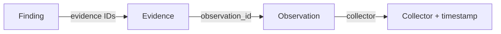

# Evidence model

A finding is only as credible as the facts it cites. NULQ makes those facts
first-class, referenceable objects.

## Shape

```json
{
  "id": "ev-36469cd2ea6f",
  "observation_id": "obs-filesystem-directory-1a2b3c4d5e6f",
  "resource": "/var/shared",
  "resource_kind": "directory",
  "collector": "linux.filesystem",
  "field": "world_writable",
  "observed_value": "true",
  "expected_value": "false",
  "explanation": "Whether the directory is writable by other.",
  "collected_at": "2026-11-21T01:38:16Z"
}
```

| Field | Purpose |
|---|---|
| `id` | Stable identifier derived from observation ID and field |
| `observation_id` | Exact observation the value came from |
| `resource` | Resource the observation describes |
| `resource_kind` | Typed resource vocabulary |
| `collector` | Provenance |
| `field` | Attribute key; empty means the resource identifier itself |
| `observed_value` | Canonical value, or `<not observed>` when absent |
| `expected_value` | Baseline where the rule has one |
| `explanation` | Why this fact matters to the finding |
| `collected_at` | When the fact was observed |

## Provenance chain



A reviewer can start at a finding, open each evidence item, and reach the
observation that recorded the fact. The collector name and timestamp tie the
observation to a collection method. Nothing in this chain requires re-running
the scan.

## Invariants enforced by the engine

1. A finding must cite at least one evidence item.
2. A finding's evidence IDs must be returned by the same rule evaluation.
3. Aggregation rejects references to evidence that does not exist.
4. Evidence IDs are deterministic: `ev-<hash(observationID, field)>`, so
   identical citations collapse instead of duplicating.

These checks run before rendering. Invalid output fails the rule and is not
published.

## Writing evidence

Use the builder in `internal/evidence`:

```go
builder := evidence.New()
id := builder.Add(observation, models.AttrMode, "Observed permission bits.")
finding.AddEvidence(id)
```

`AddExpected` records a baseline for hardening checks. An absent attribute is
recorded explicitly as `<not observed>`; rules should not invent values.

## What evidence must not contain

- file contents, password hashes, environment values, tokens or keys;
- conclusions ("this is exploitable") rather than observations;
- identifiers that cannot be resolved in the report.

## Evidence and confidence

Confidence is a property of the finding, not of each evidence item. A rule that
cites a factually observed mode has HIGH confidence in the fact; its confidence
in the *exposure* may be lower because consumers or exploitability are unknown.
Findings state that distinction in their limitations.
